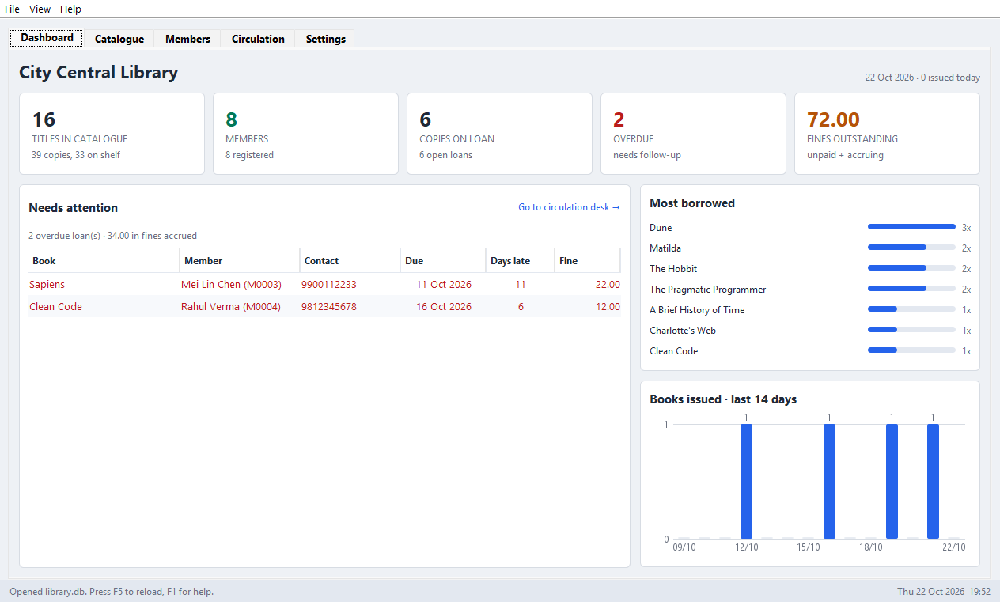
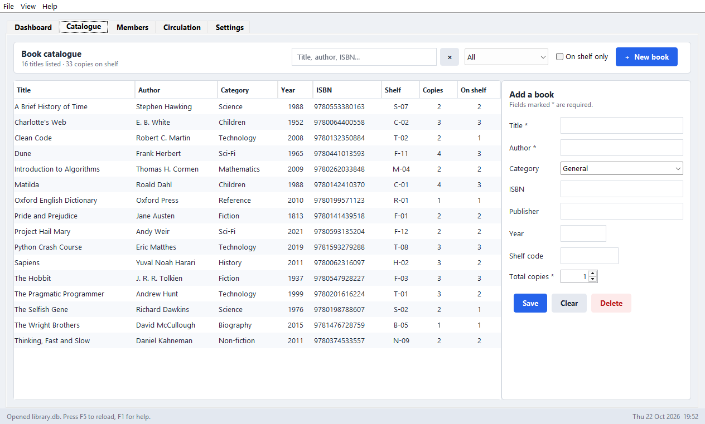
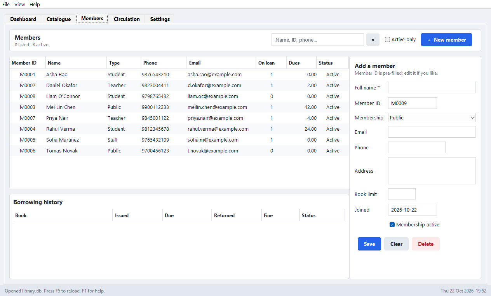
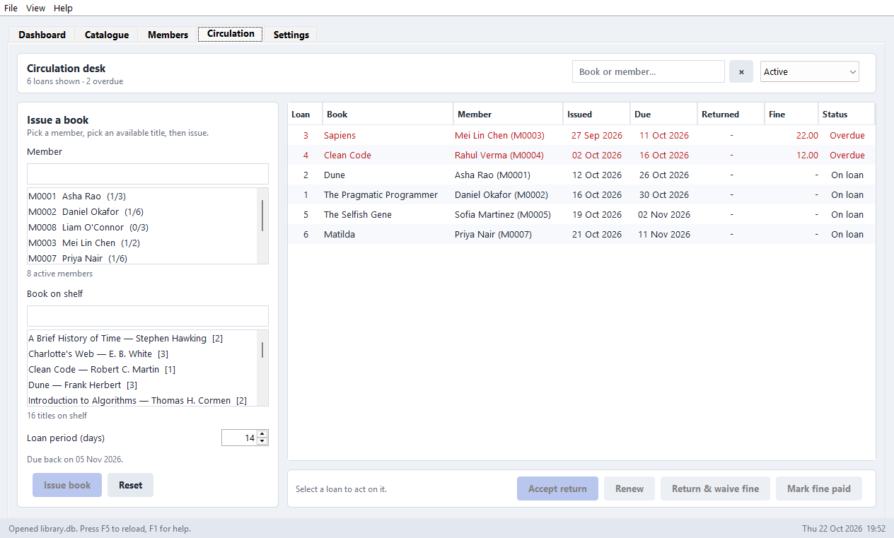
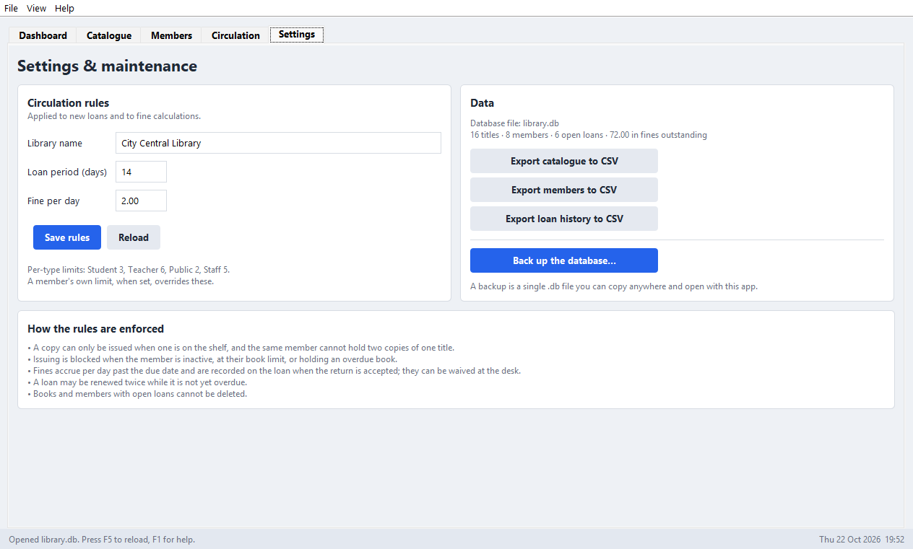

# Library Management System

A Java desktop application for running a small library: a catalogue of books,
member records, and an issue/return desk that tracks due dates and fines — all
stored in a single SQLite database file.

**Java 17+ with Swing** for the interface and **SQLite via JDBC** for storage.
One dependency, no build tool required.

## Screenshots

### Dashboard

Headline counts, the queue of overdue loans with borrower contact details, the
most-borrowed titles, and a 14-day issuing chart.



### Catalogue

Search across title, author, ISBN and publisher, filter by category or to what
is on the shelf, and add or edit records in the side form.



### Members

Member records with their borrowing limit and dues; selecting one shows their
full borrowing history underneath.



### Circulation desk

Type to filter a member and an available title, then issue. Overdue loans are
flagged in red with the fine accrued so far.



### Settings

Circulation rules, CSV exports and database backup.



## Quick start

On Windows:

```bash
run.bat --demo
```

`--demo` seeds a sample library (16 titles, 8 members, 16 loans including
overdue ones) the first time it runs, so there is something to click on. Drop
the flag to start with an empty database:

```bash
run.bat
```

`run.bat` compiles the project first if `build\classes` is missing. To build
and test explicitly:

```bash
build.bat
```

```bash
test.bat
```

### Command-line options

| Flag | Meaning |
| --- | --- |
| `--db PATH` | Use a different database file (default `library.db` beside the scripts) |
| `--demo` | Seed sample records if the database has no books yet |
| `--help` | Print the options and exit |

### Other platforms

The scripts are Windows batch files, but nothing else is Windows-specific. On
macOS or Linux (note the `:` classpath separator):

```bash
find src/main/java -name '*.java' > sources.txt && javac -d build/classes -cp lib/sqlite-jdbc-3.50.3.0.jar @sources.txt
```

```bash
java -cp "build/classes:lib/sqlite-jdbc-3.50.3.0.jar" com.library.Main --demo
```

## Requirements

- **JDK 17 or newer** (developed against JDK 26). `java -version` should work
  from a terminal.
- **sqlite-jdbc**, already in `lib/sqlite-jdbc-3.50.3.0.jar`. If it is missing,
  download it from
  [Maven Central](https://repo1.maven.org/maven2/org/xerial/sqlite-jdbc/3.50.3.0/)
  and drop it in `lib/`. The driver bundles the native SQLite library for every
  common platform, so there is nothing else to install.

On JDK 24+ the launcher passes `--enable-native-access=ALL-UNNAMED`, which
silences the warning the driver would otherwise print when it loads its native
library.

## The five tabs

**Dashboard** — headline counts (titles, members, copies on loan, overdue,
fines outstanding), the queue of overdue loans with borrower contact details,
the most-borrowed titles, and a 14-day issuing chart.

**Catalogue** — every title with its copy counts. Search across title, author,
ISBN and publisher, filter by category or to what's on the shelf, and add, edit
or delete records in the side form. Titles with nothing left on the shelf are
highlighted.

**Members** — member records with membership type, contact details, borrowing
limit and status. Selecting a member shows their full borrowing history and what
they currently owe.

**Circulation** — the working desk. Type to filter a member and an available
title, set the loan period, and issue. The loan list filters by status (active,
on loan, overdue, returned, unpaid fines) and offers accept return, return and
waive the fine, renew, and mark fine paid.

**Settings** — library name, loan period and fine per day; CSV exports for the
catalogue, members and loan history; and a one-click database backup.

## Circulation rules

These live in `LibraryDatabase`, not in the interface, so the UI cannot get
around them:

- A copy is only issued when one is on the shelf, and one member cannot hold two
  copies of the same title.
- Issuing is refused when the member is inactive, already at their book limit,
  or holding anything overdue.
- Book limits come from the membership type (Student 3, Teacher 6, Public 2,
  Staff 5); a limit set on the member record overrides it.
- Fines accrue per day past the due date. The amount is written to the loan when
  the return is accepted, and can be waived at the desk or marked paid later.
- A loan can be renewed twice, and only while it is not yet overdue.
- Books and members with open loans cannot be deleted.

Changing the loan period or fine rate in Settings affects new loans and ongoing
fine calculations; loans already issued keep their due dates.

## Keyboard shortcuts

| Keys | Action |
| --- | --- |
| `Ctrl+1` … `Ctrl+5` | Jump to a tab |
| `Ctrl+F` | Focus the search box |
| `Ctrl+N` | Start a new book / member record |
| `F5` | Reload every tab from the database |
| `F1` | Shortcut help |
| `Esc` | Clear the search box |
| `Ctrl+Q` | Quit |

Double-clicking a row edits it in the catalogue and members tabs, and accepts
the return at the circulation desk. Clicking a column heading sorts by it.

## Project layout

```
build.bat / run.bat / test.bat   compile, run, test
lib/sqlite-jdbc-3.50.3.0.jar     the only dependency
src/main/java/com/library/
    Main.java                    entry point and command-line options
    SampleData.java              demo catalogue, members and loan history
    model/                       Book, Member, Loan and the view records
    db/
        LibraryDatabase.java     schema, queries and all circulation rules
        LibraryException.java    rule violations, shown to the user as text
        BookDraft, MemberDraft   form input, validated by the data layer
        LoanFilter.java          the status filter at the desk
    ui/
        LibraryFrame.java        window: tabs, menu, status bar, shortcuts
        Theme.java               palette, fonts, formatting helpers
        Dialogs.java             modal prompts behind an interface
        AppContext.java          what a tab needs from the window
        TabPanel.java            shared tab plumbing
        DashboardPanel, BooksPanel, MembersPanel,
        CirculationPanel, SettingsPanel
        components/              CardPanel, DataTable, FormGrid, SearchField,
                                 Picker, StatCard, FlatButton, BarChart
src/test/java/com/library/
    TestHarness.java             tiny assertion runner (no test-framework JAR)
    DatabaseTests.java           rules, validation, persistence (47 tests)
    UiTests.java                 drives the real Swing panels (23 tests)
    RunTests.java                runs both suites
```

## Data model

Four tables in one SQLite file, with foreign keys on:

- **books** — title, author, ISBN (unique), category, publisher, year, shelf,
  `total_copies` and `available_copies` (kept in step with the open loans by a
  constraint and by every write path).
- **members** — `member_code` (unique, auto-assigned as `M0001`, `M0002`, …),
  name, contact details, membership type, join date, active flag, optional
  personal book limit.
- **loans** — book, member, issue date, due date, return date, renewal count,
  fine and whether it has been paid.
- **settings** — the editable rules.

Every write runs inside a transaction that rolls back on failure, so an
interrupted issue or return never leaves the copy counts wrong.

## Tests

```bash
test.bat
```

70 tests, no test framework needed. The database suite covers validation, the
circulation rules, fine arithmetic, persistence across reopening the file, CSV
export and backup. The UI suite builds the real `LibraryFrame` against a
temporary database, stubs the modal dialogs through the `Dialogs` interface, and
exercises the panels — adding and deleting books, rejecting invalid input,
issuing and returning at the desk, charging and waiving fines, renewing, and
saving settings. They skip themselves if no display is available.

## Notes

- The database is a single file. Copy it to move the library, or use
  **Settings → Back up the database** for a consistent copy while the app is
  running.
- Dates are handled in local time throughout, including the SQLite comparisons
  that decide what counts as overdue — `date('now')` in SQLite is UTC, which is
  a day out for part of every day.
- CSV exports open directly in Excel or any spreadsheet.
