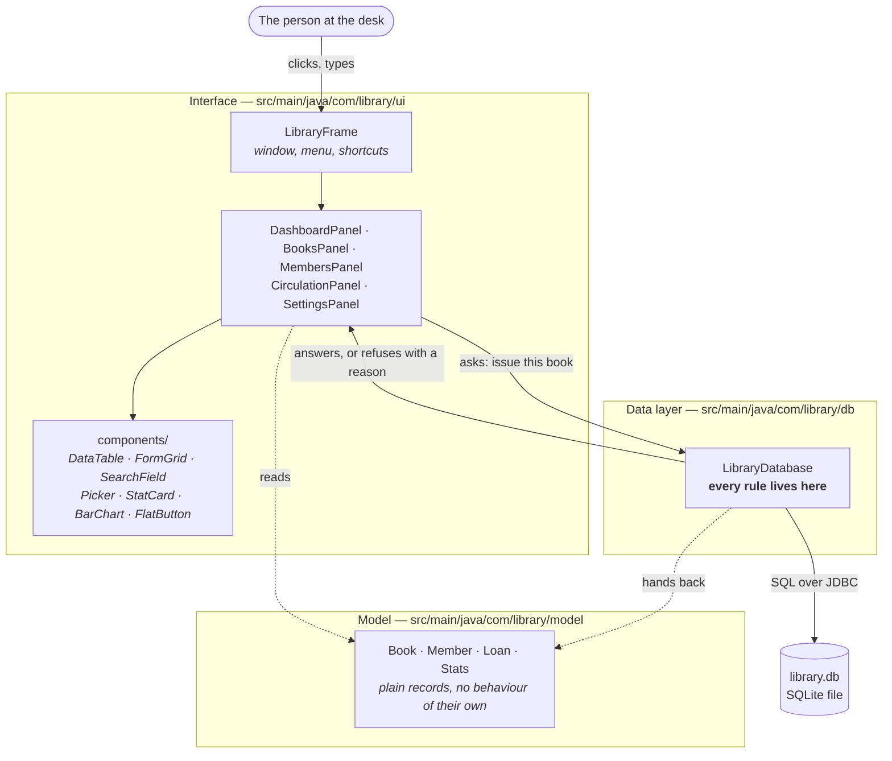
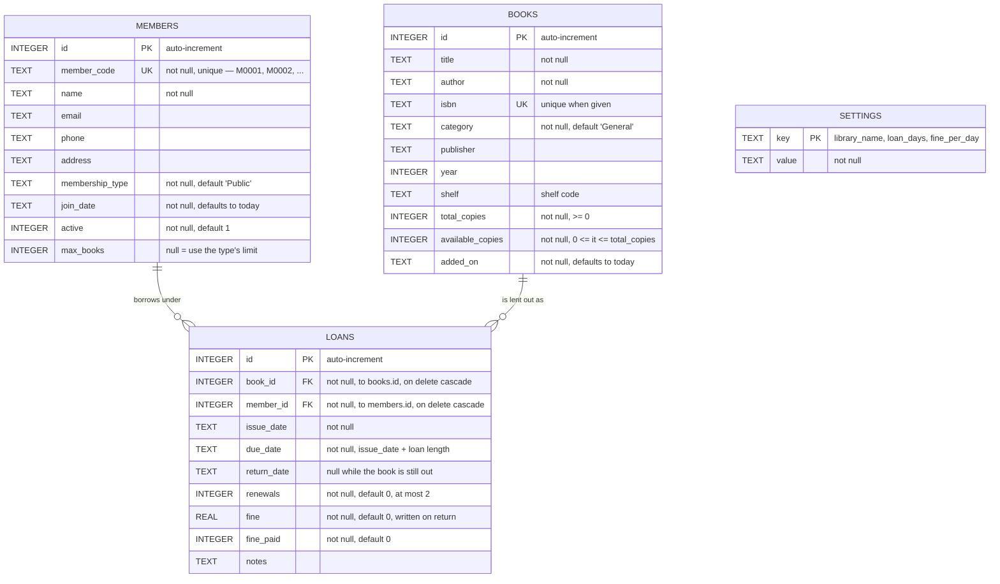
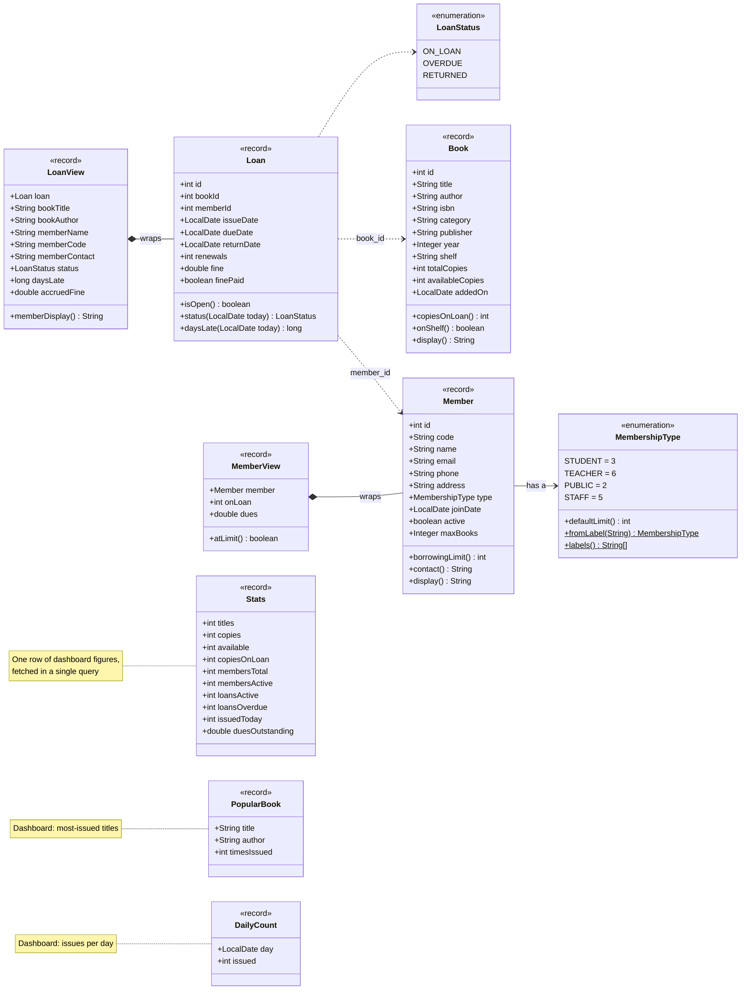
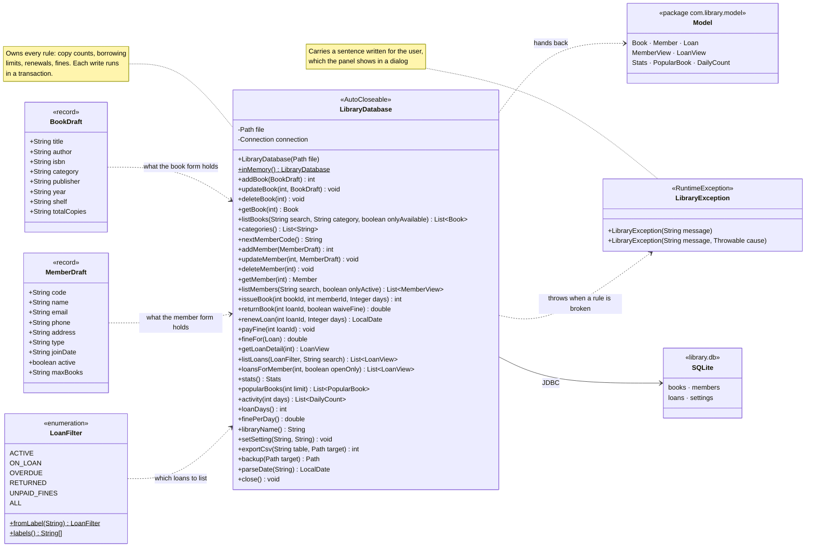
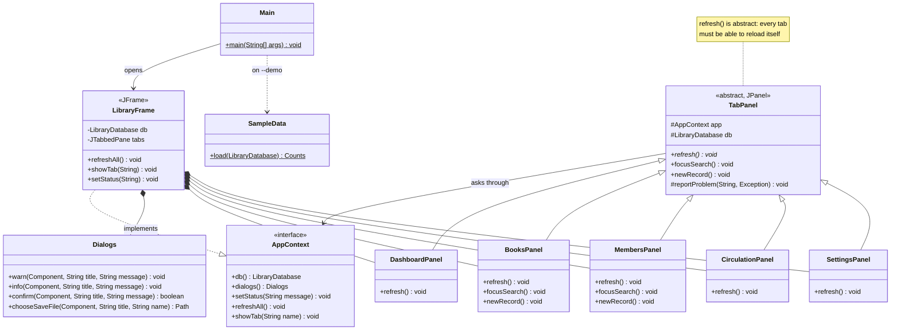
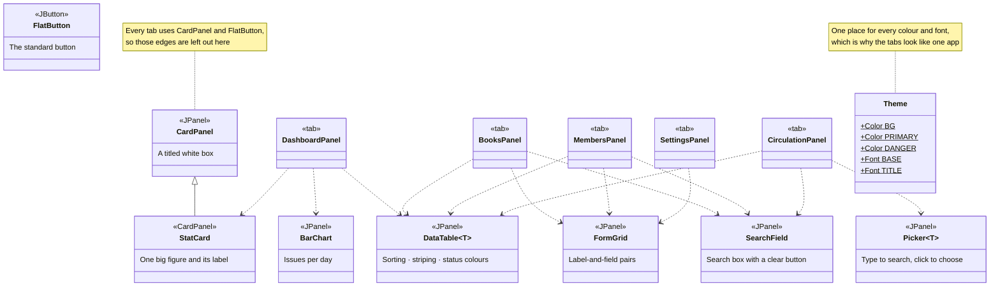

# Diagrams

The database and the code, drawn out. Three views:

1. [Layers](#1-layers) — the one idea the whole project is built on
2. [ER diagram](#2-er-diagram) — the four tables and how they relate
3. [Class diagram](#3-class-diagram) — the Java classes, in four readable pieces

Six diagrams in all, each also saved as a PNG and an SVG in
[`docs/diagrams/`](diagrams) for pasting into a report or a slide.

The diagrams are written in [Mermaid](https://mermaid.js.org), so GitHub draws
them on this page automatically. The text next to each one is the explanation
you would give out loud while pointing at it.

---

## 1. Layers



**What to say about it.** The code is split in two, and the split is the design.
`LibraryDatabase` owns the data *and* every rule about it — copy counts,
borrowing limits, renewal limits, fines. The interface classes only draw screens
and pass on what you typed; they never decide whether something is allowed. When
a rule is broken the data layer throws a `LibraryException` carrying a sentence
meant for the user, and the panel shows it in a dialog.

Two things follow from that, and both are worth claiming:

- A rule **cannot be skipped by accident** from a button, because no button is
  able to write to the database itself.
- The rules can be **tested without opening a window** — which is why 47 of the
  70 tests run in milliseconds with no screen at all.

---

## 2. ER diagram



### Reading it

**Two entities and one relationship.** A book and a member are the two real
things; a **loan** is the relationship between them, made into a table of its own
because it carries its own data — when it went out, when it is due, when it came
back, what was owed. `members` to `loans` is one-to-many, and `books` to `loans`
is one-to-many, which together make lending a **many-to-many** relationship
resolved through `loans` as the junction table.

**`settings` stands alone** on purpose. It is a key–value table, not a row of
columns, so a new setting is a new row rather than a schema change.

**Why `return_date` is allowed to be empty.** It is the one field that says
whether a loan is finished. `return_date IS NULL` means the book is still out,
and that single test is what the dashboard counts, what the overdue list
filters on, and what blocks a delete. The status an examiner sees in the
interface is worked out from it, not stored:

| Status | When |
| --- | --- |
| On loan | `return_date` is empty and `due_date` has not passed |
| Overdue | `return_date` is empty and `due_date` has passed |
| Returned | `return_date` is set |

**Where `available_copies` comes in.** You could count open loans every time you
want to know what is on the shelf. Instead the number is kept in the row and
moved by one each time a book is issued or returned — faster to read, and it is
what the catalogue shows. The risk with a kept total is that it drifts out of
step with the loans, so three things guard it:

- a `CHECK` that it can never go below zero or above `total_copies`,
- every issue and return runs as **one transaction** — the loan row and the copy
  count move together or neither moves,
- a test that issues and returns the whole sample library and then checks every
  count still adds up.

**Rules the tables enforce by themselves,** before any Java runs: a book needs a
title and an author; two books cannot share an ISBN; two members cannot share a
member code; copies cannot go negative; a loan cannot point at a book or a member
that does not exist.

**Rules the tables cannot express,** which is why `LibraryDatabase` exists: one
copy per person per title, the per-member borrowing limit, "no new loans while
something is overdue", suspended members, at most two renewals, and the refusal
to delete anything with a book still out.

### Indexes

Five, each for a query the app runs constantly:

| Index | On | Why |
| --- | --- | --- |
| `idx_loans_member` | `loans(member_id)` | a member's borrowing history |
| `idx_loans_book` | `loans(book_id)` | is this title out, and with whom |
| `idx_loans_due` | `loans(due_date)` | the overdue list and the dashboard |
| `idx_books_title` | `books(title)` | catalogue search and sorting |
| `idx_members_name` | `members(name)` | member search |

---

## 3. Class diagram

Split into four so each fits on a page: the **model** (what a book, a member
and a loan are), the **data layer** (the one class that owns the rules), the
**window and its tabs**, and the **reusable pieces** the tabs are built from.

### 3a. The domain model

The plain descriptions of a book, a member and a loan — no database, no screen.



#### Reading it

**Records, not classes with setters.** `Book`, `Member` and `Loan` are Java
**records**: immutable, and holding nothing but their own fields. They have no
database connection and cannot save themselves. A `Book` handed to a panel
therefore cannot be altered behind the data layer's back.

**The methods on them are pure arithmetic** over their own fields, which is why
they belong here rather than in the database class — `daysLate()` subtracts two
dates, `onShelf()` asks whether `availableCopies > 0`, `borrowingLimit()` picks
the member's own limit over their membership type's default. None of them touch
SQL, so all of them can be tested on their own.

**`Loan` holds `bookId` and `memberId`, not a `Book` and a `Member`.** That
mirrors the foreign keys in the table exactly and stops one loan from dragging a
whole object graph into memory with it. When a screen needs the names as well,
it asks for a `LoanView`.

**Views are a record plus the columns a screen needs.** A `LoanView` is a `Loan`
with the book's title and author, the borrower's name and contact, the status,
and the fine as it stands today. The database works all of that out in **one
`JOIN`**, which is what stops a table of 200 loans from firing 200 extra
queries. `MemberView` does the same for a member plus their count on loan and
what they owe.

**`status` is computed, never stored.** `Loan.status(today)` returns `RETURNED`
if the book is back, `OVERDUE` if the due date has passed, otherwise `ON_LOAN` —
so the status can never fall out of step with the dates it is derived from.

**The enums carry the rules they describe.** `MembershipType` keeps each type's
default borrowing limit next to its name, so the numbers live with the thing they
describe instead of in an `if` chain somewhere else.

### 3b. The data layer

One class, and everything it needs to talk to.



#### Reading it

**One class owns the data and the rules together.** That is deliberate. If the
rules lived in the panels, there would be five places to get them wrong; here
there is one, and it is the only code in the project that holds a database
connection.

**Drafts are what a *form* contains, not what a *row* contains.** Notice every
field of `BookDraft` is a `String` — including `year` and `totalCopies`. The user
may well have typed "twenty" into a number box. The draft carries the text across
untouched and `LibraryDatabase` does the checking, so **validation happens in one
place** rather than being re-written in each panel. The `of(...)` helper on each
draft exists for the tests and the sample data, which already have proper values.

**`LibraryException` is a `RuntimeException` on purpose.** It carries a message
written for the user — "Asha already has a copy of this title" — not a stack
trace. A panel catches it and shows the message as-is, so nothing has to be
translated on the way out.

**Transactions are the safety net.** Issuing a book writes a loan row *and*
decreases `available_copies`. Both happen inside one transaction, so a failure
halfway cannot leave the copy count disagreeing with the loans.

**`inMemory()` is why the tests are fast.** It opens the same schema in RAM
instead of a file, so each of the 47 database tests gets a clean library in
milliseconds and leaves nothing behind on disk.

#### The full API, by area

| Area | Methods |
| --- | --- |
| Lifecycle | `LibraryDatabase(Path)`, `inMemory()`, `file()`, `location()`, `today()`, `close()` |
| Settings | `getSetting`, `setSetting`, `loanDays`, `finePerDay`, `libraryName` |
| Books | `addBook`, `updateBook`, `deleteBook`, `getBook`, `listBooks` (×2), `categories` |
| Members | `nextMemberCode`, `addMember`, `updateMember`, `deleteMember`, `getMember`, `listMembers` (×2) |
| Circulation | `issueBook`, `returnBook`, `renewLoan` (×2), `payFine`, `fineFor` |
| Loan reads | `getLoan`, `getLoanDetail`, `listLoans`, `loansForMember` |
| Dashboard | `stats`, `popularBooks`, `activity` |
| Files | `exportCsv`, `backup` |
| Helpers | `parseDate`, `connectionForSeeding` |

### 3c. The window and its tabs



#### Reading it

**`TabPanel` is the shape of a tab.** Each of the five screens inherits from it
and must supply `refresh()` — *reload yourself from the database*. That one
abstract method is what lets `LibraryFrame` answer `F5` by looping over the tabs
and calling `refresh()` on each, without knowing what any of them contain.
`focusSearch()` and `newRecord()` have do-nothing defaults so `Ctrl+F` and
`Ctrl+N` are safe to press on a tab with no search box or form; the two panels
that have them override them. This is **polymorphism doing real work**, rather
than appearing in a project for the sake of it.

**`AppContext` is an interface so a tab never depends on the window.** A tab
needs exactly four things from the application — the database, the dialogs, the
status bar, and the ability to send the user to another tab — and `AppContext`
is that list written down. `LibraryFrame` implements it. Because the tabs are
typed against the interface rather than the frame, the UI tests can hand them a
stand-in, which is how 23 tests drive the real screens on a machine with no
display.

**Errors take one path out.** `TabPanel.reportProblem()` catches a
`LibraryException` and passes its message to `Dialogs.warn()`. Every refusal the
data layer makes therefore reaches the user the same way, and no panel writes its
own error popup.

**`SampleData` is the one deliberate exception, and it is worth being able to
explain.** Its books and members go in through the ordinary `addBook` and
`addMember`, exactly as your typing would. Its *loans* do not: a demo library
needs loans that went out three weeks ago and are already overdue, and
`issueBook` can only issue a book **today** — correctly, since a librarian
cannot lend something retrospectively. So `SampleData` asks for
`connectionForSeeding()` and writes those backdated rows itself. It still does
the work the data layer would have done — it refuses to issue a copy that is not
on the shelf, decreases `available_copies` to match, and wraps both writes in one
transaction — which is why the sample library passes the same consistency test a
real one does. That method is named the way it is so nothing else is tempted to
use it.

### 3d. The reusable pieces

The tabs are assembled out of these rather than out of raw Swing.



#### Reading it

**`components/` exists to stop seven copies of the same code.** `DataTable<T>`
is generic over the row type and wraps the sorting, striping and status
colouring every table wants — written once, used by four tabs. `FormGrid` lays
out label-and-field pairs. `Picker<T>` is the type-to-search box used for
choosing a member and a book at the circulation desk. `CardPanel` is the titled
box they all sit in, and `StatCard` — the big figures across the top of the
dashboard — is a `CardPanel` with a number in it, which is the one piece of
inheritance among the components.

**`Theme` is why it looks like one application.** Every colour and font is a
constant in that file. Changing `PRIMARY` restyles every button, heading and
selected row in the app at once, and nothing anywhere else calls `new Color(...)`.

**Generics are doing real work here.** `DataTable<Book>` on the catalogue tab and
`DataTable<LoanView>` at the circulation desk are the same class; the compiler
keeps the row types apart, so selecting a row hands back a `Book` or a `LoanView`
with no casting and no chance of mixing them up.

## Putting the diagrams in a report

Every diagram on this page is also saved as a ready-made image file, so you can
drop one straight into a report or a slide without redrawing it:

| Diagram | Image files |
| --- | --- |
| Layers | [`01-layers.png`](diagrams/01-layers.png) · [`.svg`](diagrams/01-layers.svg) |
| ER diagram | [`02-er.png`](diagrams/02-er.png) · [`.svg`](diagrams/02-er.svg) |
| Domain model | [`03a-model.png`](diagrams/03a-model.png) · [`.svg`](diagrams/03a-model.svg) |
| Data layer | [`03b-data-layer.png`](diagrams/03b-data-layer.png) · [`.svg`](diagrams/03b-data-layer.svg) |
| Window and tabs | [`03c-window.png`](diagrams/03c-window.png) · [`.svg`](diagrams/03c-window.svg) |
| Reusable pieces | [`03d-components.png`](diagrams/03d-components.png) · [`.svg`](diagrams/03d-components.svg) |

Use the **SVG** where your tool accepts it — it stays sharp however much you
enlarge it, which matters on a projector. Use the **PNG** anywhere that will not
take an SVG; they are rendered at 3× size, so they survive being blown up to
fill a slide.

The Mermaid code on this page is the master copy and the images are exports of
it. If you change the code, re-export with
[mermaid-cli](https://github.com/mermaid-js/mermaid-cli):

```bash
npx @mermaid-js/mermaid-cli -i diagram.mmd -o diagram.svg -b white
```

Or paste a single diagram's code — everything between the ```` ```mermaid ````
fences — into the [Mermaid Live Editor](https://mermaid.live) and use
**Actions → PNG / SVG**.
